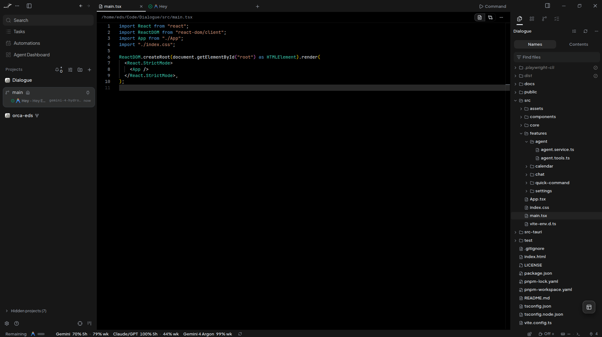
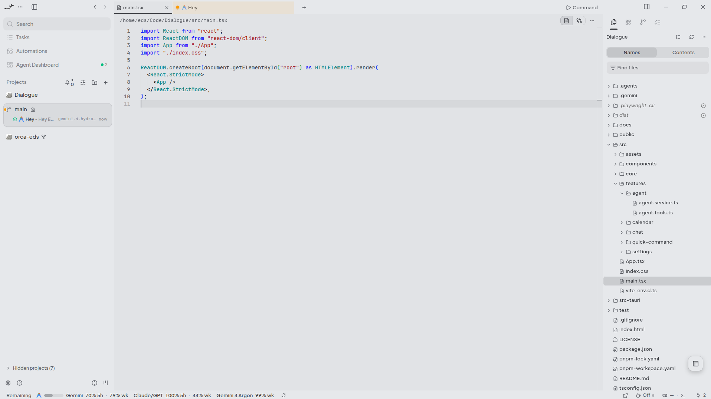

# Borderless Mono

Borderless monochrome dark and light app and terminal themes for Orca.



## Themes

- `Borderless Mono Dark` (`themes/dark.json`, `terminal/dark.json`): Deep black chat, editor, and terminal canvas (`#000000`) with borderless neutral charcoal sidebars (`#171717`), cool white text (`#e6eaf0`), and muted syntax/ANSI colors.
- `Borderless Mono Light` (`themes/light.json`, `terminal/light.json`): Cool-neutral light gray chat, editor, and terminal canvas (`#e1e3e6`) with borderless lighter sidebars and user chat bubbles (`#e6e8eb`), paired with chromatic ink syntax/ANSI colors.



## Develop

```sh
orca plugin validate .
orca plugin dev watch .    # loads this folder into Orca and reloads on save; Ctrl-C unloads it
```
